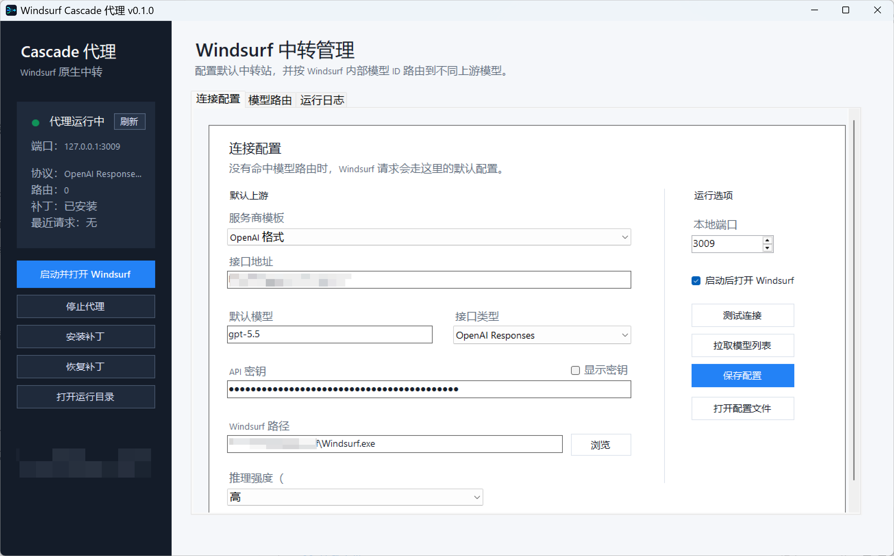

# Windsurf Cascade Proxy

Windsurf Cascade Proxy 是一个 Windows 桌面工具，用来把 Windsurf Cascade 的原生请求转发到你自己的上游模型接口。

它适合这样的场景：你想在 Windsurf 的原生 Cascade 体验里，使用 OpenAI Responses / Chat、OpenAI 兼容中转站、DeepSeek 官方 API，或者 Anthropic Messages 兼容接口。

> 本项目不是反向代理 Windsurf 内置模型，也不提供任何免费模型额度；它只是把 Windsurf Cascade 请求转发到用户自己配置的 API。

当前仓库从 `v0.1.0` 作为首个公开版本发布。

## 界面预览



## 功能特性

- 图形界面配置上游地址、API Key、默认模型和本地端口。
- 支持 OpenAI Chat、OpenAI Responses、Anthropic Messages 三种接口类型。
- 支持按 Windsurf 内部模型 ID 配置模型路由。
- 支持 OpenAI 官方 API、OpenAI 兼容中转站、DeepSeek 官方 API 与 Anthropic 兼容接口。
- 支持测试连接、拉取模型列表、从日志发现 Windsurf 模型 ID。
- 支持安装 / 恢复 Windsurf 本地补丁。
- 支持系统托盘、后台代理状态检查和运行日志查看。
- 支持推理 / 思考强度参数，并在上游不支持时自动降级重试。

## 工作原理

程序会做三件事：

1. 在本机启动一个只监听 `127.0.0.1` 的 Node.js 代理服务。
2. 给 Windsurf 安装本地补丁，让 Cascade 请求转发到本机代理。
3. 代理根据配置把请求转换并转发到你的上游 API。

简化流程：

```text
Windsurf Cascade
    -> 本机代理 127.0.0.1:3009
    -> OpenAI / OpenAI-compatible / DeepSeek / Anthropic-compatible API
```

## 系统要求

- Windows 10 / Windows 11
- Windsurf
- Node.js 18 或更高版本
- 可用的上游 API Key

程序本体是单个 EXE，但代理运行依赖系统中的 Node.js。

## 已测试环境

`v0.1.0` 已在 Windsurf Windows x64 `2.3.9` 上测试。

Windsurf 更新可能会改变 Cascade 相关的本地文件结构。如果更新后消息无法发送，建议先在本工具中恢复补丁，再重新安装补丁并重启 Windsurf。

## 快速开始

1. 下载 Release 里的 `WindsurfCascadeProxy-v0.1.0.exe`。
2. 启动程序。
3. 在“连接配置”里填写：
   - 服务商模板：`OpenAI 格式`
   - 接口地址，例如 `https://api.openai.com/v1`
   - API 密钥
   - 默认模型，例如 `gpt-5.5`
   - 接口类型，例如 `OpenAI Responses`
4. 点击“测试连接”，确认上游可用。
5. 点击“安装补丁”。
6. 点击“启动代理”或“启动并打开 Windsurf”。
7. 在 Windsurf 里选择 BYOK / Claude 相关模型并发送消息。

更详细的说明见 [docs/USAGE.md](docs/USAGE.md)。

## 模型路由

模型路由用于把 Windsurf 内部模型 ID 映射到不同上游模型。

例如：

| Windsurf 模型 ID | 上游模型 | 接口类型 |
| --- | --- | --- |
| `MODEL_CLAUDE_4_SONNET_THINKING_BYOK` | `gpt-5.5` | OpenAI Responses |
| `MODEL_CLAUDE_4_OPUS_THINKING_BYOK` | `claude-sonnet-4-5` | Anthropic Messages |
| `swe-1-6` | `gpt-5.1` | OpenAI Responses |

如果某个 Windsurf 模型 ID 没有命中路由，会走“连接配置”里的默认上游。

## 配置和日志位置

程序运行数据保存在：

```text
%LOCALAPPDATA%\WindsurfCascadeProxy\
```

主要文件：

- `WindsurfCascadeProxy.log`：应用运行日志。
- `Runtime\windsurf-proxy.stdout.log`：代理标准输出日志。
- `Runtime\windsurf-proxy.stderr.log`：代理错误日志。
- `Runtime\windsurf-proxy-config.json`：本地配置文件。

API Key 当前按明文保存在本机配置文件里，请不要把配置文件上传到 GitHub。

## 构建

在 Windows PowerShell 中运行：

```powershell
powershell.exe -NoProfile -ExecutionPolicy Bypass -File .\build-polished-exe.ps1
```

输出文件：

```text
dist\WindsurfCascadeProxy.exe
```

构建要求：

- Windows
- .NET Framework 编译器 `csc.exe`
- Node.js 用于检查代理脚本

详细说明见 [docs/DEVELOPMENT.md](docs/DEVELOPMENT.md)。

## 风险说明

这个工具会修改本机 Windsurf 安装目录中的部分脚本，以便把 Cascade 请求指向本机代理。程序提供“恢复补丁”按钮，但 Windsurf 更新后仍建议重新检查补丁状态。

本项目与 Windsurf、Codeium、OpenAI、Anthropic、DeepSeek 没有关联，也不是官方项目。

## 常见问题

见 [docs/TROUBLESHOOTING.md](docs/TROUBLESHOOTING.md)。

## 许可证

本项目使用 MIT License，见 [LICENSE](LICENSE)。
